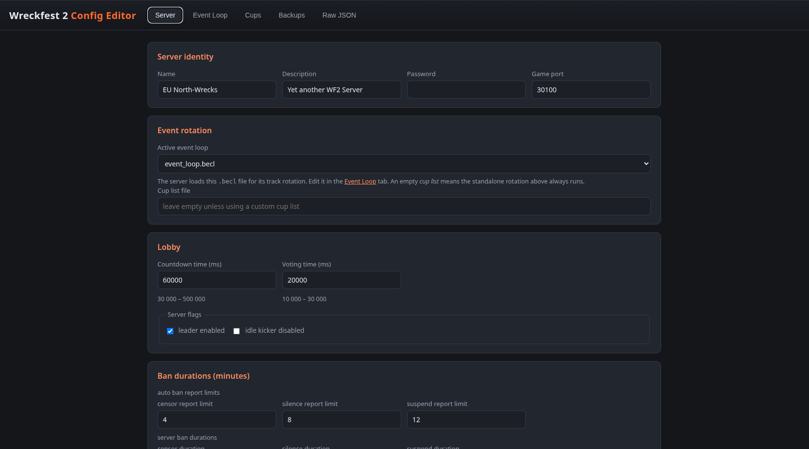
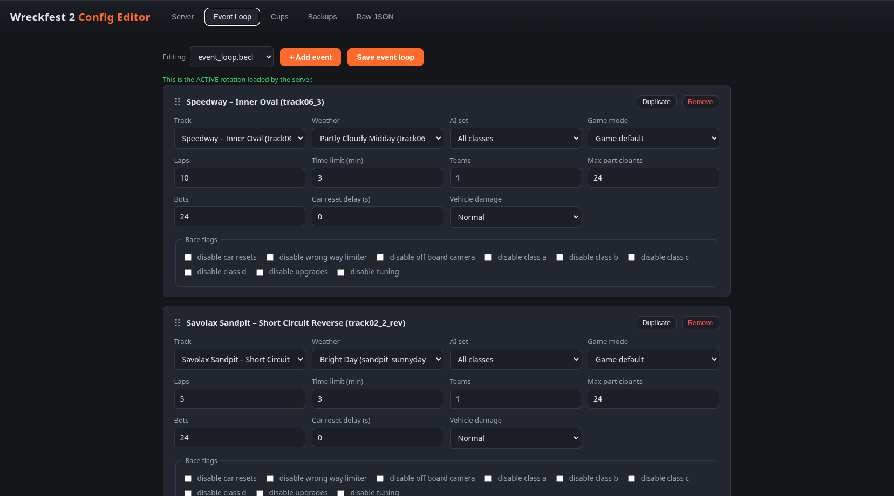

# Wreckfest 2 Docker Server

Run a headless Wreckfest 2 dedicated server in Docker using Wine for seamless Linux compatibility.

Based on the [nvitaterna/wreckfest2-docker-server](https://hub.docker.com/r/nvitaterna/wreckfest2-docker-server) console image, extended with a local build layer that adds Xvfb and gosu so the server runs fully headless with persistent logs and configuration.

## Features

- **Headless operation** — Xvfb provides a virtual display, no GUI required.
- **No game file uploads needed** — SteamCMD downloads the dedicated server (~10 GB) anonymously on first start and checks for updates on every start.
- **Automatic updates** — every container start runs `steamcmd +app_update 3519390 validate`, which applies game updates and repairs missing/corrupted files.
- **Persistent storage** — bind mounts for configs, logs, and game files survive container recreation.
- **Interactive console** — attach to the running server to issue commands.
- **Web config editor** — bundled GUI (`config-editor/` service) for editing `server_config.scnf`, event loops, and cup configs with dropdowns for all tracks, weathers, AI sets, and game modes (details below).
- **Local image** — builds as `wreckfest2-docker-server:local`, distinct from the upstream image, so Compose can never silently fall back to an outdated pulled image (this previously caused a crash loop with `gosu: command not found` / `Xvfb: command not found`).

## Requirements

- Docker and Docker Compose
- ~4 GB RAM and a multi-core CPU
- Internet access (SteamCMD download/update)
- UDP port 30100 reachable by players

## Quick Start

1. Clone this repo and navigate to it:
   ```bash
   git clone https://github.com/scheissegalo/Wreckfest2-Dedicated-Server-Docker && cd Wreckfest2-Dedicated-Server-Docker
   ```
2. Create the host directories (game files are **not** needed — SteamCMD fetches them):
   ```bash
   mkdir -p config logs wf2-server
   ```
3. Put your server config files in `./config`:
   - `server_config.scnf`
   - `event_loop.becl`
   - `default_loop.becl`
   - (optional) `server_privilege.sprv` — admins/moderators/bans; see [Full config reference & admin list](#full-config-reference--admin-list). Ready-made templates: `config/example_server_config.scnf` and `config/example_server_privilege.sprv`.
4. Build and start:
   ```bash
   docker compose up -d --build
   ```
   `--build` is required on first start so the local image (with Xvfb/gosu) is built. `docker-compose.yml` and `Dockerfile` must be in the same directory.
5. Watch the first boot download the game and start the server:
   ```bash
   docker compose logs -f
   ```
   The initial download is several GB and takes a while. Later boots validate and update quickly, then launch the server.
6. Connect clients to your host's IP on **UDP 30100** (the server also appears in the in-game server list).
7. If using UFW (recommended):
   ```bash
   ufw allow 30100/udp
   ```

## Updating

- **Game updates:** automatic — SteamCMD runs on every container start.
- **Image/Dockerfile changes:** run `docker compose up -d --build` again.
- **Server config changes:** edit files in `./config`, then `docker compose restart wreckfest-server`.

## Interactive Console

```bash
docker compose attach wreckfest-server
```

Type `help` for available commands.

Use **CTRL-C** to detach from the console. Only use `exit`/`quit` if you actually want to stop the server.

## Logs

| File | Content |
|---|---|
| `docker compose logs -f` | Full startup console (SteamCMD, Wine, game server output) |
| `logs/wf/server.log` | Game server log (may stay empty while running; live output is in `docker compose logs`) |
| `logs/wine/stdout.log`, `logs/wine/stderr.log` | Wine output |
| `logs/x/stdout.log`, `logs/x/stderr.log` | Xvfb output |

Log files are gitignored; empty `.gitkeep` placeholders keep the directories in a fresh clone.

## Web Config Editor

A small web GUI ships in this repo (`config-editor/` service) for editing the three config files without hand-editing JSON. It runs alongside the game server and is bound to **localhost only** by default.

```bash
docker compose up -d --build config-editor
# then open http://127.0.0.1:8085
```

### What it does

- **Server tab** — edit server name, description, password, port, countdown/voting times, server flags, ban durations, and pick which `.becl` event loop is active (no more guessing whether `default_loop` or `event_loop` is loaded — the Event Loop tab also badges the active file).

  

- **Event Loop tab** — edit any `.becl` file: add/remove/duplicate/reorder (drag) events; per-event dropdowns for **track** (pretty names like "Speedway – Inner Oval", extracted from the game files, with ID fallback), **weather** (filtered to the selected track's venue, pretty names), **AI set** (virtual class sets + on-disk sets like "American Cars"), and **game mode** (banger race, derby, deathmatch, folk race, suicide race, waypoint race). Rules fields (laps, time limit, participants, bots, damage, reset delay, race flags) are validated.

  
- **Cups tab** — edit `server_cup_config.ccnl`: cups players vote between in the lobby, including scoring, start order, car restrictions, and which event loop each cup runs.
- **Backups tab** — every save creates a timestamped backup under `config/.backups/` (last 50 kept per file); restore from the tab with one click.
- **Raw JSON tab** — escape hatch to edit any config file as text with server-side validation.

Track, weather, and AI metadata is **scanned from the mounted game files at runtime** (`./wf2-server` is mounted read-only), so dropdowns stay current after game updates automatically.

### Full config reference & admin list

The game ships a packed (non-readable) `default_server_config.scnf`; to see every option with representative values, use the bundled **`config/example_server_config.scnf`**. It mirrors exactly the structure the game itself writes (same keys, same nesting) so you can copy values from it into your real `server_config.scnf`:

| Key | Meaning |
| --- | --- |
| `net server config[0]` | `name`, `description`, `password`, `log file name`, `game port` |
| `game server config[0]` | `cup list`, `event loop name`, `countdown time`, `voting time`, `flags` |
| `...["auto ban report limits"][0]` | `censor/silence/suspend report limit` (reports before auto-ban) |
| `...["server/admin/default ban durations"][0]` | `censor/silence/suspend duration` (minutes) |

**Admins are not in `server_config.scnf`.** Wreckfest 2 stores per-player roles (admin/moderator/vip) and the ban list in a separate **`server_privilege.sprv`** file, which the game creates in the config dir the first time you assign a role (via the `role <SteamID64> <role>` console command, or by editing the file). See the bundled **`config/example_server_privilege.sprv`**:

```json
{
    "bbmeta": "sprv v0 n1",
    "roles": [
        { "bbmeta": "ssrl v0 n2", "platform id": 76561197999725914, "role": "admin" },
        { "platform id": 76561198000000001, "role": "moderator" }
    ],
    "bans": []
}
```

- `platform id` is the player's **SteamID64**; known roles are `admin`, `moderator`, `vip`, and `default`.
- Restart the server (`docker compose restart wreckfest-server`) after changing either file.
- The example files are inert (`example_*`); the game only reads `server_config.scnf` and `server_privilege.sprv`.

> **Ownership note:** the editor writes files as root but now preserves each file's existing owner/group, and `entry.sh` re-chowns the whole config dir on startup — so the game (running as `steam`) can keep saving its configs. If a previous edit left `server_config.scnf` root-owned and you saw `Server Error: Failed to save server config`, just restart the container.

### Creating event-loop presets

- **Generate a loop** — the Event Loop tab's **+ Generate…** button builds a new `.becl` from the game's levels over the HTTP API (`POST /api/generate-loop`). Pick all levels (45), race levels only (36), or the waypoint/suicide levels only (9); each level's **native game mode** is used by default (race levels stay normal race, the `_sr` levels run Suicide Race, and the `_1`/`_6` waypoint layouts run Waypoint Race), or force one or more modes onto every level. Rules (laps, time limit, teams, participants, bots, reset, damage) and weather/AI set are applied to every generated event. The shipped **`all_tracks.becl`** was produced exactly this way: all 45 levels, native modes, 5 laps, 3 min, 24 participants, 8 bots.
- **"+ New loop"** creates an empty skeleton preset you fill in by hand.

```bash
# equivalent, from the command line (editor credentials via .env):
curl -u admin:PASSWORD -X POST http://127.0.0.1:8085/api/generate-loop \
  -H 'Content-Type: application/json' \
  -d '{"name":"all_tracks","modes":["intrinsic"],"laps":5,"time_limit":3,
       "max_participants":24,"bot_count":8,"reset_delay":2}'
```

- Every `.becl` file is listed in both the Event Loop tab and the Server tab's active-loop picker.
- An empty/0-byte file does **not** work — the editor writes a valid skeleton (`{"bbmeta": "becl v0 n1", "events": [...]}`).
- Switch the active loop in the Server tab, then `docker compose restart wreckfest-server` (or restart from the console).

### Securing it

By default the editor listens on `127.0.0.1:8085` only (not reachable from the network). To expose it, set environment variables (e.g. in a `.env` file next to `docker-compose.yml`):

```bash
EDITOR_BIND=0.0.0.0    # listen on all interfaces
EDITOR_USER=admin      # HTTP basic auth username
EDITOR_PASS=changeme   # HTTP basic auth password
MAX_BACKUPS=100        # optional, default 50
```

**Always set `EDITOR_USER`/`EDITOR_PASS` if you change `EDITOR_BIND` away from localhost** — the editor can change your server password and configs.

Authentication is HTTP Basic: when you open the editor, the browser shows its native login popup; enter the credentials from your `.env` once and it will remember them for the session. There is no custom login page. If you ever need to clear saved credentials, close all tabs to the editor or restart the browser.

### Notes

- Config changes only take effect after a server restart: `docker compose restart wreckfest-server`.
- The editor validates structure before saving (required fields, ranges like bots 0–24, laps 1–500) and refuses invalid JSON — it won't corrupt your configs.
- The game rewrites `server_config.scnf`/`server_cup_config.ccnl`/`server_privilege.sprv` at runtime; use the editor's Reload (Raw tab) or reload the page before editing to pick up game-side changes.

## Troubleshooting

- **Container restarts in a loop / `gosu: command not found` or `Xvfb: command not found`:** the outdated upstream image is being used. Run `docker compose build` then `docker compose up -d --force-recreate`.
- **Empty `docker compose logs` and no game output:** the server process never started — check the crash loop above, then inspect `logs/wine/stderr.log`.
- **`Permission denied` writing to `/home/steam/logs/...` on a fresh VPS/clone:** Docker creates the bind-mounted `./logs` (and `./config`) directories as root; the hardened `entry.sh` fixes ownership automatically at startup, but if you see this error you're running an old image — rebuild with `docker compose up -d --build --force-recreate`.
- **`Error: Can't open display` / `Failed creating new xdo instance` in a loop:** the virtual display (Xvfb) isn't running or the container predates the hardened entrypoint. Rebuild as above; `entry.sh` now starts Xvfb itself (clearing any stale `/tmp/.X99-lock` left by a previous run, which otherwise breaks `docker compose restart`) and only waits up to 60s for the game window instead of hanging forever.
- **`Warning: Wreckfest window not found after 60s`:** Wine failed to start the game — check `logs/wine/stderr.log`. The server keeps going (console still starts) so the warning won't mask other issues.
- **Server runs but players can't join:** forward UDP 30100 on your router (UPnP is unavailable inside the container) and check host firewall rules (`ufw allow 30100/udp`).

## Notes

- Game files in `wf2-server/` and runtime logs are gitignored — the repo stays clean for upload/deployment.
- Runtime-generated artifacts (`config/server_cup_config.ccnl`, `config/server_privilege.sprv`, `config/telemetry/`, `config/~Lock`, `config/save/`, `config/.backups/`) are also gitignored (the `example_*` files are committed).
- Check the [base image on Docker Hub](https://hub.docker.com/r/nvitaterna/wreckfest2-docker-server) for upstream updates.

Enjoy racing! 🏎️
